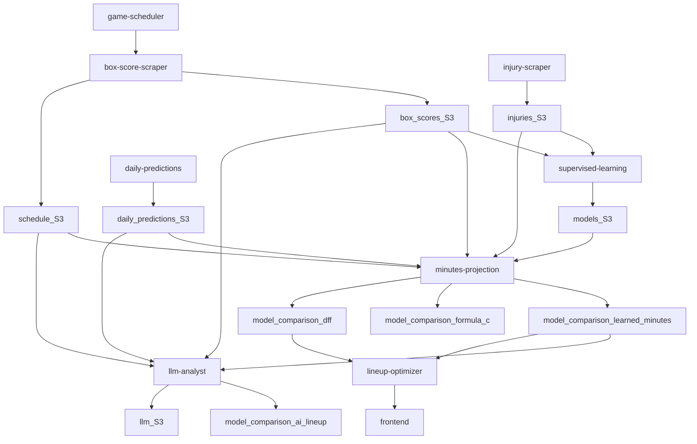

# NBA_Machine_Learning

## Overview
This repo is an AWS Lambda-based pipeline that scrapes NBA data, trains a learned minutes model, and generates DraftKings lineups and minutes projections. Data and models are stored in S3 as Parquet/PKL files (no Postgres in the current codebase).

## Key directories
- `lambda/`: All Lambda functions (one directory each with `lambda_function.py`, `requirements.txt`, `Dockerfile`) plus `deploy.py`. `lambda/shared/` holds modules several Lambdas copy in: `learned_minutes.py` (the minutes model's rows, features, training and prediction) and `player_names.py` (matching player names across sources).
- `scripts/`: Local utilities — model evaluation (`evaluate_projections.py`, `evaluate_llm.py`, `analyze_model_performance*.py`), S3 inspection, notebooks.
- `aws/`: Shared S3 utilities, inspection helpers, and the game-scheduler IAM policy document.
- `frontend/`: React + Vite viewer for the `lineup-optimizer` API (see `frontend/README.md`).
- `documentation/`: Project docs (this file, `minutes-projection.md`, `roadmap.md` (the plan) and `findings.md` (what was measured and built, with history)).
- `images/`: Figures used in analysis and docs.

## Lambda pipeline (current code)
The `lambda/game-scheduler` Lambda scrapes the DailyFantasyFuel main slate start time and schedules these functions at fixed offsets from 30 minutes before the slate (minutes in brackets):
1. [+4] `box-score-scraper` -> `data/box_scores/{season}.parquet` for the current and three prior seasons; the current season is mirrored to `data/box_scores/current.parquet`; also writes the current season's schedule to `data/schedule/current.parquet` and its game dates to `data/schedule/game_dates.json`
2. [+6] `supervised-learning` -> `models/learned_minutes.pkl`, `models/learned_minutes_feature_names.json`, `models/learned_minutes_summary.json`
3. [+9] `daily-predictions` -> `data/daily_predictions/current.parquet` (DFF projections only; no model FP here)
4. [+11] `injury-scraper` -> `data/injuries/current.parquet` (Out + Doubtful from the NBA PDF), `report_statuses.parquet` (every status), and appends the night to `history.parquet`
5. [+12] `llm-analyst` `research` -> `llm/research/{date}.json` (games with open injury news only) and the AI lineup in `model_comparison/ai_lineup/`
6. [+13] `minutes-projection` -> learned-minutes, Formula C and DFF lineups in `model_comparison/*`, and the lineup email
7. [+16] `llm-analyst` `adjustments` -> `llm/adjustments/` (the judge)
8. [+18] `llm-analyst` `preflight` -> `llm/preflight/{date}.json` and the preflight email
9. [+19] `minutes-projection` `adjusted_lineup` -> the learned model re-run with the judge's changes, saved to `model_comparison/learned_ai_adjusted/` and emailed
10. Weekly `llm-analyst` `postmortem`: switched off 2026-10-20 (reviews happen in Claude Code sessions); the action still runs by hand

`cluster-scraper` and `nba-clustering` (formerly +0 and +2) are switched off but still deployed; they only fed the barebones FP model, which is also off.

Early-season pause: until all 30 teams have played 4 games, minutes-projection builds only the DFF lineup, the adjustments judge is skipped, and preflight checks inputs only; research and the AI lineup still run (see `findings.md`, "Reference: early-season pause").

## What each Lambda does
- `cluster-scraper` (off): Pulls advanced/scoring/defense stats from the NBA API (via `PROXY_URL`) and writes `data/advanced_player_stats/current.parquet` plus a per-season copy (`{YYYY}-{YYYY+1}.parquet`).
- `nba-clustering` (off): Runs PCA + KMeans on multiple seasons of advanced stats and writes `data/clustered_players/current.parquet`.
- `box-score-scraper`: Pulls box scores from the NBA API, calculates DraftKings FP, adds rolling/career features, and writes seasonal + current Parquet files (the cluster join is switched off). Also saves the season schedule (`GAME_DATE`, `GAME_ID`, `TEAM`, `OPPONENT`, `IS_HOME`), which tells minutes-projection which teams play tonight.
- `supervised-learning`: Trains the learned minutes model on the current season and the three before it, using the injury report history, and publishes it with its feature list and a training summary. The barebones FP model's training is kept but switched off (`TRAIN_BAREBONES`).
- `daily-predictions`: Scrapes DailyFantasyFuel projections and writes `data/daily_predictions/current.parquet` (PPG projection, salary, position, starter status).
- `injury-scraper`: Scrapes the official NBA injury report PDF and writes `data/injuries/current.parquet` with `OUT` players (Out and Doubtful) and estimated injury dates, `data/injuries/report_statuses.parquet` with every listed status, and appends the night's statuses to `data/injuries/history.parquet` (the minutes model's training history; seeded with archived 2022-26 pre-tip reports).
- `minutes-projection`: Projects minutes with the learned model (our #1) and Formula C (control), turns them into FP with each player's season FP per minute, builds those two lineups plus DFF's, writes them to `model_comparison/*`, and emails them. See `minutes-projection.md`.
- `llm-analyst`: Claude (Opus 5.5) components: nightly per-game web research, the AI lineup (one AI-picked lineup per slate, emailed with the AI-adjusted lineup), the adjustments judge (shadow mode; it sees what the learned model already adjusted), the preflight check, and the weekly post-mortem (switched off). Reads the API key from the `CLAUDE_API_KEY` environment variable; spend is capped per run ($6.50) and per day ($10) and logged, web searches included, to `llm/usage/{date}.json`; the monthly backstop is the Anthropic Console spend limit.
- `lineup-optimizer` (standalone): Serves the lineup the email uses (learned model, or DFF's while paused) to the frontend through API Gateway. It is not part of the game-scheduler pipeline.

## S3 schemas and inspection
- `s3_bucket_test_results.txt` is the authoritative schema snapshot for all S3 buckets.
- `scripts/test_s3_buckets.py` regenerates that file by inspecting bucket keys.

## Season handling
Every Lambda derives the current season from the date (July onward = new season) and reads the three prior seasons by name; nothing is hardcoded to a year. Injury reports come from `official.nba.com/nba-injury-report-{season}-season/` with a fallback to the prior season's page.

## Deployment
Docker Desktop must be running. `python lambda/deploy.py <function> [...]` or `--all` builds each image for `linux/amd64`, pushes it to ECR tagged with a UTC timestamp (and `:latest`), updates the function, and waits for it to become active. The AWS CLI is resolved from `.venv/Scripts/` if not on PATH; put `.venv/Scripts` first on PATH before running, because `aws.cmd` otherwise runs the system Python, which lacks `awscli`. Functions (and their ECR repos) are created once by hand; the script only updates code. The llm-analyst function also needs the `CLAUDE_API_KEY` environment variable, set by hand.

## Monitoring
Each Lambda raises on failure so the `AWS/Lambda Errors` metric fires. CloudWatch alarms `nba-lambda-errors-<function>` (all nine pipeline functions, including `llm-analyst`) publish to the `lineup-optimizer-notifications` SNS topic (email). `game-scheduler` treats a missing DailyFantasyFuel slate as an error only between Oct 15 and Jun 25, and schedules nothing on days with no regular-season games per `data/schedule/game_dates.json` (preseason, All-Star break).

## Evaluation
`scripts/evaluate_projections.py` scores stored minutes projections and lineups against actuals, split by data-freshness regime (see the docstring for the 2025-26 regimes). Run it before judging any model change. `scripts/evaluate_llm.py` scores the adjustments judge and the AI lineup and reports LLM spend. `scripts/backtest_vs_dff.py` is the head-to-head with DFF on 2025-26.

## Roadmap
`documentation/roadmap.md` is the plan: status, decisions in force, the ordered steps with how each is judged, and the AI pieces with their kill rules. `documentation/findings.md` holds the evidence: every backtest, negative result and the done log.

## Frontend
`frontend/` is a React + Vite app that reads the `lineup-optimizer` API (see `frontend/README.md`).

## Dependency constraints (Lambda)
Lambda runtimes must stay on NumPy 1.24.x-compatible wheels to avoid sklearn pickle issues.
Recommended pins for Lambda: numpy==1.24.3, scipy==1.11.4, pandas==2.1.3, scikit-learn==1.5.2.

## FlowChart (current pipeline)

